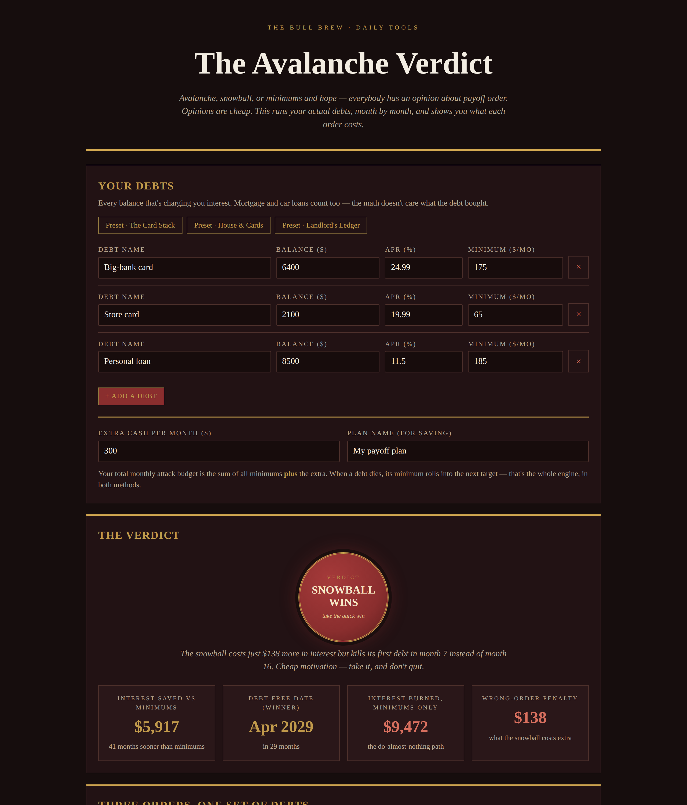

# The Avalanche Verdict

**Live:** https://thebullbrew.github.io/avalanche-verdict/
**Repo:** https://github.com/thebullbrew/avalanche-verdict

## What it does

Everybody has an opinion about payoff order — avalanche, snowball, or minimums and hope. Opinions are cheap. The Avalanche Verdict runs your actual debts month by month and prices each order: enter every balance with its APR and minimum, plus the extra cash you can throw at the pile each month. You get a seal verdict — AVALANCHE WINS / SNOWBALL WINS / CLOSE CALL / PAY MORE — interest saved versus minimums-only, the winner's debt-free date, the interest the minimums-only path burns, and the wrong-order penalty in plain dollars.

It also shows all three strategies side by side (debt-free date, months, total interest, first debt gone), the winner's attack order with the month each debt dies, a $0–$500/mo extra-cash sensitivity table, three presets (card stack, house & cards, landlord's ledger), saveable plans in your browser, and a one-tap copy summary.

## The method behind it

- **Real simulation, not a rule of thumb.** Interest accrues on every balance at APR ÷ 12 each month, minimums are paid on everything, and the remaining budget attacks one target at a time. When a debt dies, its freed minimum rolls into the next target — in both methods. Minimums-only never rolls anything; freed money is treated as spent, which is what actually happens to most people.
- **Avalanche** targets the highest APR first — mathematically the cheapest order, always. **Snowball** targets the smallest balance first — it costs a little interest and buys quick wins. The verdict prices that trade honestly: if the snowball's penalty is trivial (under $150 or 3% of avalanche interest) and it kills a first debt at least 3 months sooner, the seal goes to the snowball. Motivation you actually use beats a perfect plan you quit in March.
- **The honest warning built in:** the gap between minimums-only and *either* method dwarfs the gap between the two methods. The order debate should never delay the extra payment.

## How to run

Open `docs/index.html` in any browser, or serve the `docs/` folder with any static host. It is a fully self-contained single-page app with a minimal PWA shell (manifest + service worker) — no backend, no build step, no accounts, and every calculation happens locally on your device.

*Design: Dark aesthetic variation 2 — Oxblood Study (near-black oxblood, double gold rules, oxblood primary buttons with gold text, oxblood seal verdicts, red reserved for the money you're burning).*
